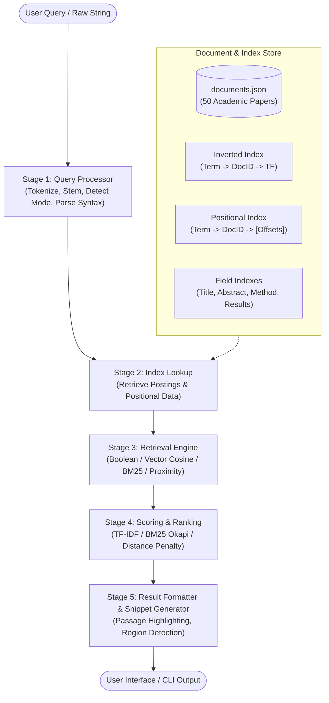

# Search Engine Architecture & Pipeline Specification

## Overview
The **Mini IR Search Engine** follows a modular information retrieval pipeline designed for high maintainability, extensibility, and clarity across academic retrieval paradigms.

---

## Detailed Pipeline Stages

### Stage 1: Query Processing
- **Input**: Raw text query (e.g. `"artificial intelligence"`, `AI AND healthcare NOT imaging`, or `artificial NEAR/3 healthcare`).
- **Actions**:
  1. Detect quoted phrase syntax for exact phrase matching.
  2. Parse Boolean operators (`AND`, `OR`, `NOT`).
  3. Detect proximity keywords (`NEAR/N`).
  4. Perform lowercase normalization, token extraction via regular expressions, stopword removal, and Porter Stemming.
- **Output**: `ParsedQuery` object containing structured metadata and normalized tokens.

### Stage 2: Index Lookup
- **Input**: `ParsedQuery` tokens and target field scope (All, Title, Abstract, Methodology, Results).
- **Actions**:
  1. Access the pre-computed `IndexStore`.
  2. Retrieve posting lists `{doc_id: term_frequency}` for each token.
  3. Retrieve positional lists `{doc_id: [positions...]}` when phrase or proximity constraints apply.
- **Output**: Posting and positional sets for candidate generation.

### Stage 3: Retrieval Engine
- **Modes**:
  - **Boolean Retrieval**: Executes set operations (Intersection `&`, Union `|`, Set Difference `-`).
  - **Vector Space Retrieval**: Projects query onto TF-IDF vector space with cosine similarity.
  - **BM25 Retrieval**: Computes probabilistic relevance using Okapi BM25 (`k1=1.5`, `b=0.75`).
  - **Proximity / Phrase Retrieval**: Verifies adjacency (`pos2 - pos1 == 1`) or proximity (`|pos2 - pos1| <= N`).
  - **Field / Non-Overlapped Retrieval**: Evaluates field-weighted occurrences or union-merges distinct field posting sets.

### Stage 4: Scoring & Ranking
- **Actions**:
  1. Aggregate scores based on the active retrieval model.
  2. Apply field weight multipliers (e.g., Title: 2.0x, Abstract: 1.0x, Methodology: 0.5x, Results: 0.5x).
  3. Sort candidate documents in descending score order.
- **Output**: Ranked list of `(doc_id, score)` tuples.

### Stage 5: Result Formatting & Region Retrieval
- **Actions**:
  1. Join document identifiers with document metadata (Title, Authors, Abstract, Methodology, Results).
  2. Perform sentence splitting and compute query term overlap per field.
  3. Highlight the most relevant region/passage for each returned result.
- **Output**: Formatted document result objects ready for Streamlit UI rendering and CLI demos.
